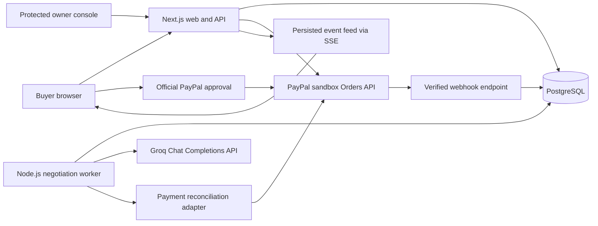

# System architecture

> October 19 approved scope update: [Marketplace expansion](16-marketplace-expansion.md) supersedes the original single-category discovery/UI boundary below. Native negotiation and PayPal integrity requirements remain in force.

## Architectural baseline

Use a TypeScript modular application with two deployable processes: a Next.js web/API service and a Node.js background worker. PostgreSQL is the durable source of truth for catalog data, workflow checkpoints, offers, inventory, payments, and events.

This separation keeps model latency outside browser request lifetimes while retaining a small operational footprint. Start with one web instance and one worker. No Redis, vector database, microservice mesh, or external agent protocol is required for P0.

## Context diagram



The reconciliation adapter belongs to the same codebase and runs in the worker; it is not an additional deployed service. Payment creation and capture are driven by explicit browser-approved checkout actions. The negotiation LLM has no payment tools or credentials.

## Modules and ownership

| Module | Responsibilities | Must not do |
| --- | --- | --- |
| Web UI | Brief editing, offer board, human approval, receipts, owner forms | Calculate authoritative prices or infer payment success from a redirect |
| HTTP API | Validate requests, enforce ownership, create commands, serve redacted views | Expose raw seller context or trust browser-supplied totals |
| Domain | Constraints, policy validation, scoring, versions, offer snapshots, state transitions | Call providers or depend on UI components |
| Workflow | Claim jobs, schedule agent turns, checkpoint results, append events | Hold a database transaction during a network call |
| AI adapter | Build role-specific context, call structured model decisions, track usage | Directly mutate catalog, inventory, or payment state |
| Database | Transactions, uniqueness, ownership links, job leases, event persistence | Depend on in-memory worker state for correctness |
| Payment adapter | Sandbox OAuth, order creation, capture, verification, reconciliation | Accept arbitrary remote URLs, merchant IDs, or payment amounts from agents |

## Chosen technologies

| Layer | Selection | Reason |
| --- | --- | --- |
| Language | TypeScript in strict mode | Shared contracts and a small toolchain |
| UI and server | Next.js App Router on Node.js | One web application for screens and HTTP endpoints |
| Styling | CSS modules and scoped styles with accessible native controls | Fast consistent product UI; custom room composition |
| Data validation | Zod plus database constraints | Validate browser inputs and model proposals at explicit boundaries |
| Database | PostgreSQL with Prisma for schema and ordinary queries | Relational ownership and transactional inventory/payment records |
| Job claiming | PostgreSQL jobs table with short transactional claims and leases | Durable execution without another datastore; reviewed SQL where ORM support is insufficient |
| Live updates | Server-sent events; polling fallback | One-way persisted progress with reconnect support |
| AI | Official Groq JavaScript SDK (`groq-sdk`), Chat Completions API | Strict JSON action decisions behind a provider adapter |
| Payments | PayPal browser checkout component plus server REST Orders API | Inspectable payment boundary and exact server-owned totals |
| Tests | Vitest, real PostgreSQL integration tests, Playwright | Pure rules, transaction races, and browser flows need different coverage |
| Package manager | pnpm workspaces | Shared domain and integrations across web and worker |
| Deployment | Render web service, background worker, PostgreSQL | Fits a persistent worker and sponsor alignment |

Select supported stable dependency versions and a supported Node.js LTS release during M0, then pin the lockfile and runtime. Start with Groq-hosted `openai/gpt-oss-20b`, subject to the M0 capability/quality check. See the [Groq plan](14-groq-ai-plan.md) for the account limits and adapter contract.

## Planned repository structure

```text
pactra/
  README.md
  LICENSE
  docs/                       specifications in this planning pack
  assets/                     brand, demo fixtures, source references
  apps/
    web/                      Next.js screens, APIs, PayPal webhook receiver
    worker/                   negotiation turns, expiry and reconciliation jobs
  packages/
    domain/                   pure business rules and shared schemas
    database/                 Prisma schema, migrations, reviewed transaction helpers
    integrations/             AI and PayPal adapters
  tests/
    integration/              PostgreSQL and provider adapter tests
    e2e/                      buyer and owner browser journeys
    evals/                    structured agent behavior fixtures
  infra/                      deployment configuration added during implementation
```

The application workspace now exists. This document remains the target architecture; see [implementation status](15-implementation-status.md) for implemented modules, verification, and remaining differences.

## Durable workflow

1. An authenticated browser command creates a brief version and a negotiation job in one database transaction.
2. A worker claims a ready job with a bounded lease. It snapshots the brief and each seller's current policy version.
3. Each step has a unique key containing session, brief version, seller or buyer role, and round. Completed validated step output is checkpointed.
4. Three independent seller steps are scheduled per round. The free-tier baseline permits one active room and one model request in flight across the shared Groq quota. Buyer counters wait for the completed round or its deadline. Increase request concurrency only if the account limits and measured token usage permit it.
5. Each result is validated against the current job generation before becoming an offer or event. Old-version results cannot be published as current.
6. A lease expiry allows another worker to resume from checkpoints. Repeated LLM calls after a crash are possible; repeated accepted effects are prevented by unique step keys and compare-and-set transitions.
7. Per-session limits, provider limits, and cancellation are checked before each call. All model calls, including web-origin brief interpretation and owner tests, use one database-backed quota scheduler. The brief endpoint returns a retryable waiting response if quota cannot be acquired promptly. No job can loop indefinitely.

## Events and live delivery

Append domain events in the transaction that commits the relevant state change. Give each room a monotonically increasing sequence number. SSE sends only the viewer-authorized public projection. A reconnect includes the last received sequence; the API replays later events from PostgreSQL. Treat delivery as at least once; clients deduplicate by event ID.

If SSE is unavailable, poll the same projection with a cursor every two seconds, increasing to five seconds while idle. Emit a heartbeat on connected SSE streams. The UI reads current state after reconnect so it is not dependent on receiving every historical event.

## Deployment and environments

Local development uses web, worker, and a local PostgreSQL instance. A local HTTPS tunnel is optional for exercising genuine PayPal webhook delivery. Unit and provider-contract tests do not need live credentials.

The hosted demo uses three Render resources and a shared server-side configuration. [Render background workers](https://render.com/docs/background-workers) run continuously without receiving incoming HTTP requests. Treat service filesystems as temporary; durable state belongs in PostgreSQL, consistent with [Render's deployment guidance](https://render.com/docs/deploys).

CI runs validation, type checks, relevant tests, and application builds. Deployment runs migrations once as a controlled release step before compatible services start. Keep web and worker on the same source revision and shared contract version. Provider credentials exist only in server environments; the browser receives only the PayPal public client ID required by the checkout component.

## Trust boundaries

Buyer free text, seller descriptions, model outputs, browsers, and webhook requests are all untrusted inputs. Only application validators can turn a proposal into an offer. Only the payment module can turn an approved snapshot into a PayPal operation. Only a verified provider result can establish a payment state. Owner access is separate from guest access.

## Future evolution

External seller agents can later implement the same structured proposal contract behind an authenticated adapter. Real merchant settlement would require an explicit PayPal platform integration and onboarding plan. Keep that behind the payment adapter and merchant identity model; do not represent a simulated storefront ID as a real PayPal merchant account.
