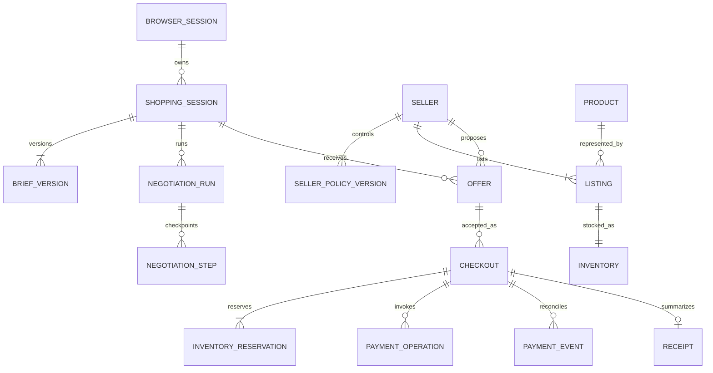

# Data and API contracts

> October 19 approved scope update: [Marketplace expansion](16-marketplace-expansion.md) supersedes the original single-category discovery/UI boundary below. Native negotiation and PayPal integrity requirements remain in force.

This is the target logical schema and contract specification. The first database migration and HTTP handlers now exist; not every planned entity or owner route has shipped. See [implementation status](15-implementation-status.md) and the source schema for the current implementation.

## Conventions

- Opaque UUID-like identifiers; possession of an ID never grants access.
- Integer cents for money, USD in P0, with fixed precision at provider serialization boundaries.
- UTC timestamps in storage and ISO 8601 API values; user-facing schedule dates use Africa/Nairobi.
- Immutable brief versions, policy versions, offer versions, accepted snapshots, and append-only audit events.
- Validated JSON payloads carry explicit schema versions. Sensitive policy fields never enter buyer projections.
- Mutations accept an idempotency key where repetition could create duplicate work. An identical key with a different payload returns a conflict.

## Logical entities

| Entity | Core fields and constraints |
| --- | --- |
| `browser_sessions` | ID, hashed opaque credential, created/expiry timestamps; 24-hour guest access |
| `shopping_sessions` | Owner session FK, active brief version, job generation, lifecycle state, active checkout ID |
| `brief_versions` | Session FK, version, user text, public request, private cap, requirements, normalized weights; unique session/version |
| `sellers` | Stable ID, display name, public strategy, active policy version, demo merchant mapping |
| `seller_policy_versions` | Seller FK, version, private floors/allowed terms/strategy, created timestamp; immutable published versions |
| `products` | Product ID, role, public capabilities, compatibility, fictional capability score |
| `listings` | Seller/product FK, listing ID, list price, active flag; floor comes from versioned policy |
| `inventory` | Listing FK, on-hand quantity, revision; on-hand must not fall below active held units |
| `negotiation_runs` | Session/brief/generation, state, request and usage counters, deadline, prompt/schema versions |
| `negotiation_steps` | Run, round, role/seller, step key, input references, structured result, validation status; unique step key |
| `offers` | Session, brief, seller, policy and offer versions, exact validated terms, computed total, eligible reasons, expiry, status |
| `room_events` | Session, sequence, event type, public projection, restricted metadata reference; unique session/sequence |
| `jobs` | Type, entity key, state, attempts, next-run time, lease owner/expiry, checkpoint, safe error code |
| `ai_quota_reservations` | Provider organization/model scope, request key, estimated input/output reservation, actual usage, status, reset/cooldown metadata; shared by web and worker |
| `checkouts` | Session/offer FK, immutable agreement JSON and hash, status, approval deadline, PayPal order/capture IDs |
| `inventory_reservations` | Checkout, listing, quantity, state, expiry; all items acquired in a transaction |
| `payment_operations` | Checkout, kind, request key, lease/state, provider reference, attempt metadata; unique operation/request key |
| `payment_events` | Provider event ID, signature result, linked checkout, restricted payload, processing state; unique provider event ID |
| `receipts` | Checkout FK unique, payment-state projection, snapshot reference, created/updated timestamp |
| `owner_sessions` | Hashed opaque credential, privilege scope, expiry; never interchangeable with guest credentials |

Avoid duplicating a mutable price or stock field in multiple authoritative tables. Offer JSON is a historical snapshot, not an inventory source.

## Entity relationships

Cancelled/failed attempts may leave multiple historical checkouts; enforce at most one unresolved active checkout and one completed purchase per shopping session. A new purchase requires a new session.

## Lifecycle state machines

**Negotiation run:** `queued -> running -> completed | no_deal | cancelled | failed | limit_reached`. A cancelled generation cannot publish current offers. Partial valid offers can remain selectable if the current brief and seller offer are still active.

**Offer:** `active -> superseded | expired | invalidated | locked`. Eligibility is an explicit computed result alongside lifecycle. `locked` belongs to its checkout and does not become a reusable active offer after cancellation; renegotiate or create a fresh current offer.

**Checkout:** `reserved -> creating_order -> awaiting_approval -> capturing -> paid`. Supported branches include `cancelled`, `expired`, `failed`, `pending`, `reconciling`, and `review_required`. Only explicitly safe unpaid states release stock. `paid` may later project `refunded` or `reversed` with the original capture preserved. Provider state and local operation state are separate fields to represent uncertainty.

**Job:** `ready -> leased -> succeeded`, with `retry_scheduled`, `cancelled`, or `dead` branches. Lease expiry can retry a checkpointed step. Do not treat job failure as proof that a payment failed.

## Proposed HTTP surface

All routes are prefixed `/api`. Responses contain either validated data or a stable error envelope with error code, safe message, retryability, and correlation ID.

| Method and route | Input | Effect / output |
| --- | --- | --- |
| `POST /guest-session` | No personal profile needed | Issue 24-hour opaque HttpOnly browser credential with rate limiting |
| `POST /briefs/interpret` | Free text, supported preset ID, command key | Groq-backed structured draft/clarification; retryable quota-wait response if not admitted promptly; no negotiation starts |
| `POST /shopping-sessions` | User-confirmed structured brief and command key | Persist session/v1 and enqueue its run |
| `GET /shopping-sessions/:id` | Ownership cookie | Redacted current state and eligible offer summaries |
| `POST /shopping-sessions/:id/revisions` | Expected brief version, revised requirements, command key | Atomically create v2 or return conflict/checkout lock |
| `POST /shopping-sessions/:id/stop` | Expected generation | Stop further agent calls; preserve current valid offers |
| `GET /shopping-sessions/:id/events` | Sequence cursor or Last-Event-ID | Owned SSE stream; cursor-based JSON fallback supported |
| `GET /offers/:id` | Ownership cookie | Exact public offer and constraint results |
| `POST /checkouts` | Offer ID, expected brief/offer version, command key | Snapshot and atomic reservation, or explicit conflict |
| `GET /checkouts/:id` | Ownership cookie | Agreement and accurate payment state |
| `POST /checkouts/:id/paypal-order` | Checkout ID in route, command key | Create/reuse matching PayPal order; no supplied amount |
| `POST /checkouts/:id/capture` | Expected PayPal order ID, command key | Capture/reconcile owned checkout under payment gates |
| `POST /checkouts/:id/cancel` | Expected state/version | Cancel only if safe; otherwise return pending reconciliation |
| `GET /receipts/:id` | Ownership cookie | Receipt linked to actual capture and agreement |
| `POST /webhooks/paypal` | Provider headers and body | Durable verified-event intake; no browser cookie requirement |
| `POST /owner/login` | Owner secret in request body | Rate-limited exchange for separate secure owner session |
| `GET /owner/sellers` | Owner cookie | Policies, inventory, and draft/publication metadata |
| `POST /owner/sellers/:id/policy-versions` | Expected version and validated changes | Publish new policy and invalidate affected unlocked offers |
| `POST /owner/demo-reset` | Explicit reset confirmation and command key | Reset synthetic data only if no unresolved payments or holds |
| `GET /health/live` | None | Process health without secrets |
| `GET /health/ready` | Internal/protected detail | Database readiness and compatible schema version |

CSRF protection applies to browser-origin mutations. The webhook endpoint uses provider verification instead. Unknown or unowned IDs return a uniform not-found response.

## Event vocabulary

`brief.confirmed`, `brief.revised`, `run.started`, `seller.responding`, `offer.published`, `offer.ineligible`, `offer.superseded`, `buyer.countered`, `seller.declined`, `seller.unavailable`, `run.completed`, `run.no_deal`, `run.limit_reached`, `checkout.reserved`, `checkout.order_created`, `payment.checking`, `payment.pending`, `payment.completed`, `payment.failed`, `payment.refunded`, `payment.reversed`, `checkout.cancelled`, and `inventory.exception`.

Events contain session ID, sequence, public event ID, timestamp, brief version, type, and a minimal public payload. No private floor, raw prompt, owner credential, provider token, or payment personal detail is streamed.

## Concurrency rules

- Model request/token reservations are atomically admitted against all applicable shared Groq quota windows. Web and worker instances cannot each assume they own the full allowance.
- A revision uses an expected-version check and increments job generation atomically.
- Offer acceptance revalidates against the current brief and policy, then reserves all line items in a consistent listing lock order.
- Two create-checkout requests for one session are serialized; a command-key retry returns the same result.
- A seller policy update cannot modify an immutable checkout snapshot or reduce stock below active holds.
- Order/capture references are unique. Completion updates payment, reservation consumption, stock, and public completion event in one transaction.
- An owner reset refuses to run while an external operation is unresolved; old paid receipts remain retained for the configured audit period.

## Query and indexing plan

Index owner/session lookups, session/version offers, room event sequence, job state/next-run time, lease expiry, listing reservations, checkout status/updated time, and provider order/capture/event IDs. Use bounded pagination for history. Review actual query plans before adding speculative indexes or a cache.

## Current general-product contract — October 20

See [negotiation first](18-negotiation-first.md) for the current scope. New buyer requests include `items: [{productId, quantity}]` alongside budget and delivery limits. Exact products and quantities are checked at admission and checkout. Earlier JSON briefs without `items` retain the original camera-kit contract.

`POST /api/owner/sellers/:id/products` adds a seller product with shop access and the existing same-origin guard. Inputs include a retry key, expected rule version, product name/category/description, asking price, private minimum and stock. The product, listing and new rule-history entry are created together under the seller lock. Public bootstrap exposes product descriptions and asking prices; private minimums and instructions remain excluded. The additive `Product.description` field defaults to an empty string for earlier records.

## Real catalog management (October 20)

`POST /api/owner/sellers/:sellerId/products` creates a real product and listing; default status is `draft`. Input includes brand, description, category, up to four HTTPS images, optional source URL, asking/private minimum cents, stock, command key and expected seller version. Publishing (`status: active`) requires a photo, asking price and owner confirmation. `POST /api/owner/sellers/:sellerId/products/:listingId` edits it with additional expected product version and current on-hand/reserved counts. `archived` hides a listing; it does not delete history. Draft/archived/sample listings never enter public bootstrap. Seller-rule publishing submits only non-archived listings, while saved snapshots retain all historical listings. Brief item entries now capture optional `productVersion`, which the server fills on confirmation. Existing legacy rooms remain readable. See [catalog review](19-catalog-review.md).

## Live conversation projection

Owned room reads include `progress: {state, actor, sellerId, round}` derived from the current version’s durable job. Room events (up to 100 recent records) and the existing SSE route use the same allowlisted public projection. Raw model messages and private payload fields are not returned. New proposal events include arrival days, warranty months and request version; legacy events remain compatible. See [the live window](21-live-negotiation-window.md).
