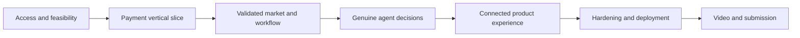

# Build roadmap and backlog

Plan date: October 17, 2026. Times and dates use Africa/Nairobi. Capacity assumption: one primary builder, about 108 focused implementation hours plus 20 contingency hours across the remaining calendar window. This is an estimate, not a commitment based on known team availability.

The submitted brief gives November 12, 2026 at 23:00 as the deadline. Target submission on November 11 at 21:00, leaving a day for corrections. Confirm the event's full official rules and submission form before spending the final buffer.

## Milestones

| Milestone | Target dates | Estimate | Exit condition |
| --- | --- | --- | --- |
| M0: feasibility and setup | Oct 18–19 | 6 h | Sandbox access verified; Groq free-tier access, default model quality, strict outputs, quota pacing, fixtures, and deployment path checked |
| M1: payment vertical slice | Oct 20–22 | 14 h | One fixed bundle can be reviewed, reserved, approved, captured, reconciled, and receipted in sandbox |
| M2: deterministic market engine | Oct 23–25 | 20 h | Catalog/policies, constraints, ranking, versions, jobs, and event feed work without LLM dependency |
| M3: live agent negotiation | Oct 26–29 | 22 h | Three separate seller agents and buyer counters run through bounded rounds; revision and no-deal work |
| M4: coherent product experience | Oct 30–Nov 2 | 18 h | All buyer screens and protected policy console connected; responsive and accessible core journey |
| M5: hardening and hosted demo | Nov 3–5 | 16 h | Concurrency, payment failures, privacy, rate limits, deployed worker, and clean setup pass |
| M6: submission and rehearsal | Nov 6–10 | 12 h | Public repository prepared, documentation verified, video recorded, Devpost draft complete |
| Submission | Nov 11 by 21:00 | Included in reserve | Submit and verify all links and access |
| Final buffer | Nov 12 until 23:00 | Reserve | Fix submission/access issues; avoid new features |

The planning pack is the pre-implementation deliverable. No milestone requiring application code or provider credentials is claimed complete now.

## Dependency order

Start with the payment spine because a convincing negotiation without a functioning accepted purchase would fail the central product promise. Domain fixtures and rough UI shells can develop alongside it, but do not polish the room before the full pipeline is viable.

## Implementation backlog

| Task | Priority | Dependency | Done when |
| --- | --- | --- | --- |
| B01 Verify developer accounts and full event requirements | P0 | None | Access, rules, and required submission links recorded |
| B02 Verify Groq model/limits and choose supported tooling versions | P0 | B01 | Tooling pinned; GPT-OSS 20B capability, account quotas, and benchmark recorded |
| B03 Scaffold workspace and database migrations | P0 | B02 | Web/worker build and connect to local PostgreSQL |
| B04 Import and validate fictional fixtures | P0 | B03 | All product/listing/policy relations and money fields valid |
| B05 Guest and owner session boundaries | P0 | B03 | Ownership and privilege negative tests pass |
| B06 Snapshot and atomic inventory reservations | P0 | B04–B05 | Last-item race produces exactly one reservation |
| B07 Sandbox create/approve/capture vertical slice | P0 | B06 | Fixed bundle yields matching completed capture |
| B08 Webhook inbox and reconciliation operations | P0 | B07 | Duplicate/uncertain capture resolves without duplicate effects |
| B09 Offer validators and compatibility checks | P0 | B04 | Impossible and below-floor proposals rejected correctly |
| B10 Ranking and explanation evidence | P0 | B09 | Hand-computed fixtures match scores and selection order |
| B11 Durable jobs, step checkpoints, and event cursors | P0 | B03 | Worker restart and browser reconnect preserve state |
| B12 Brief interpretation and confirmation | P0 | B05, B09 | Ambiguous goals clarified; confirmed requirements immutable by version |
| B13 Seller and buyer model action adapters | P0 | B02, B09 | Schema-valid decisions stay within role context |
| B14 Bounded three-round orchestration | P0 | B11–B13 | Live counters alter proposals with capped calls and duration |
| B15 Brief revision and stale-result cancellation | P0 | B14 | Old jobs/offers cannot become current checkout inputs |
| B16 Room, comparison, steering, and seller lanes | P0 | B10–B15 | Buyer can understand and change a live negotiation |
| B17 Exact review, payment states, and receipt | P0 | B07–B08, B16 | Selected live offer pays through the proven payment spine |
| B18 Protected seller policy console | P0 | B05, B09 | New versions affect future offers without leaking floors |
| B19 Shared Groq quota scheduler, redaction, and safe resets | P0 | B08, B14 | All inference shares free-tier admission; 429/reset handling works; no paid fallback or unresolved-payment reset |
| B20 Integration/evaluation/browser acceptance suite | P0 | Relevant features | Required scenarios in testing plan pass |
| B21 Deploy web, worker, database, webhook endpoint | P0 | B19–B20 | Same source revision works at a usable URL |
| B22 Verify clean-clone instructions and disclosures | P0 | B21 | Another operator can reproduce the documented setup |
| B23 Record demo and prepare submission | P0 | B22 | Under-three-minute public video and complete draft |
| B24 Publish source and submit | P0 | B23 | Public license visible, links work, entry confirmed |
| B25 Owned replay and price-history visualization | P1 | All P0 gates | Clear replay labeling; no private context leakage |
| B26 Extra preset and agreement export | P1 | B25 | Demonstrates value without destabilizing release |

## Scope cuts when schedule slips

First remove replay, charts, exports, extra presets, elaborate animations, and optional sponsor integrations. Keep three seller strategies, genuine buyer counters, one revision, exact review, actual sandbox payment, and honest failure states. Simplify the owner console to validated forms rather than dropping policy enforcement.

Do not substitute a prerecorded transcript for a live agent implementation or a fake payment result for a sandbox capture. If a required capability remains broken, describe its state honestly and fix the core path before broadening scope.

## Milestone review questions

- M0: Can this account actually make the needed sandbox calls and structured model decisions?
- M1: Can a retry or crash produce a duplicate payment or incorrect stock?
- M2: Can a model proposal ever create an impermissible offer?
- M3: Do buyer requirements and seller policies change observable decisions?
- M4: Can a new visitor understand the room and make an informed purchase?
- M5: Can judges exercise the hosted build without seeing private data or fragile setup?
- M6: Does the video show the exact working behavior claimed in the submission?
