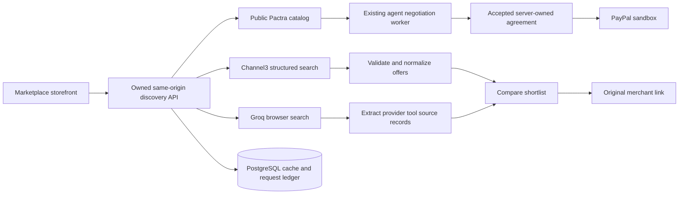

# Approved marketplace expansion

Approved by the project owner on October 19, 2026. This document supersedes the original single-category product boundary wherever they conflict. Existing negotiation/payment integrity requirements still apply. Implementation evidence belongs in document 15.

## Product promise

**Discover across stores. Compare the tradeoffs. Negotiate with participating sellers. Choose where to buy.**

Pactra is a consumer shopping marketplace with three supply paths. The shopping experience comes first: product imagery, useful search, source labels, clear prices, product details, and a comparison shortlist. Technical controls belong in the protected seller workspace.

| Supply path | Discovery | Action | Payment |
| --- | --- | --- | --- |
| Pactra sellers | Owned catalog, inventory, and policies | Negotiate supported bundles and terms | Explicit PayPal sandbox approval in Pactra |
| Channel3 | Structured search, product images, merchant offers, currencies, availability and buy links | Compare offers; visit merchant | Merchant checkout outside Pactra |
| Other marketplaces | Groq live browser search constrained to supported marketplace domains | View evidence-backed search results; visit original source | Marketplace checkout outside Pactra |

External discovery never grants negotiation, inventory reservation, merchant onboarding or payment rights. No external result is accepted by the existing checkout API. External merchants may offer their own payment options; Pactra does not promise PayPal there.

## Hackathon scope

Required next slice: a working consumer storefront; browsable native product details; source/category filters; Channel3 product search; Jumia/Kilimall/Amazon search discovery; merchant handoffs; up to three products in a comparison view; explicit fictional/native versus external source labels; preserved native negotiation and PayPal flow.

Search happens on submission, never per keystroke or initial page load. Native catalog browsing uses no provider credits. Each external source is requested separately so an unavailable provider never erases native results. Show setup, quota, timeout, empty-result and unavailable states explicitly.

The existing eight fictional creator products remain a clearly labeled demo catalog. Their illustrations are representations of fictional items. Real external product images and prices come from Channel3, not AI invention. Native negotiation currently requires a 4K camera, microphone and tripod kit; opening it must disclose this boundary. Broader native categories require new real catalog and validator work.

## Discovery architecture

Use the existing Next.js service and PostgreSQL. No new service is needed. Use the official Channel3 TypeScript SDK and its MIT React product card, with Pactra styling. External requests run with timeouts outside transactions. Browser ownership, same-origin POST validation and durable quotas protect discovery. The search ledger caches search identity for ten minutes and accounts for attempted searches, including failures. Channel3 caches only product IDs; product retrieval refreshes volatile prices, images, stock and links before display. Web discovery caches its source records for ten minutes. Native reservations and accepted agreement snapshots stay authoritative.

Groq search uses browser_search with no response_format: strict structured outputs are incompatible with browser search. Only provider tool result URLs on the chosen marketplace domain become cards. Generated answer links are never trusted as evidence. Page snippets are untrusted data and are rendered as text. Initial web results deliberately have no price, stock, shipping or exact-match guarantee. If provider source records are missing, return an honest no-results state and a clearly labeled marketplace-search handoff.

Channel3 detail views refresh the selected product again before presenting its merchant link. Offers retain supplied buy links and currencies, availability, condition and selected variants. Do not sort across currencies or promise global cheapest prices. Default relevance follows provider order. Prices exclude unverified delivery/tax costs. Native prices are demo USD item prices, distinct from negotiated all-in kit totals. Comparison is manual and does not assert that different products/variants are identical.

## Markets and provider access

Channel3's locale documentation currently lists US/Canada/UK and selected European/Australian markets; Kenya is not listed. Start its discovery using the documented default US/USD locale, visibly labeled. Jumia/Kilimall web searches initially target Kenya; Amazon targets amazon.com. Coverage is discovered from actual results, never assumed. Shopify stores can appear through Channel3; a universal Shopify marketplace search is not claimed.

Configure CHANNEL3_API_KEY locally. Hackathon offer: promo PAYPAL-HACKATHON-2026 advertises 20,000 free credits. Verify account activation and billing controls in the provider dashboard. The application has conservative daily caps and no automatic paid provider fallback. Groq search availability and tool costs require an actual account test; a text-inference free tier does not establish free search entitlement.

## Delivery phases and acceptance

1. **Storefront and discovery:** root shopping UI, native detail view, Channel3 adapter, selected-domain web search, comparison and safe handoffs. Checks: no invented prices/URLs, secrets absent from public responses, malicious URLs rejected, missing sources handled, desktop/mobile usability, preserved negotiation routes. Live Channel3 verification requires the configured key.
2. **Deal benchmark:** “Can Pactra beat this deal?” only after real native inventory can match external model, variant, condition, quantity and total-cost basis. Current fictional inventory cannot establish real external savings. Validate benchmark evidence server-side; seller policy floors and buyer approval remain mandatory.
3. **Travel:** integrate a dedicated flight search provider; compare dates, airports, baggage and fare terms with fresh pricing and booking handoff. No airline fare bargaining, fabricated routes, or production ticket issuance in the current slice.
4. **Release:** complete sandbox buyer approval/capture, public HTTPS webhooks, provider failure checks, abuse/retention hardening, hosting, accessibility review and under-three-minute video. Discovery does not replace the PayPal-centered demo.

## Demo story

A shopper searches for creator equipment, compares a real external offer and its caveats, browses the demo Pactra sellers, confirms a creator-kit brief, watches seller agents negotiate and explicitly approves the accepted agreement through PayPal sandbox. Show retailer redirects separately. Never imply fictional native products are identical to external brands.

## Official sources checked October 19, 2026

- [Channel3 search API](https://docs.trychannel3.com/api-reference/v1/search)
- [Channel3 response schema](https://docs.trychannel3.com/guides/response-overview)
- [Channel3 locales](https://docs.trychannel3.com/guides/locale)
- [Channel3 hackathon sponsor](https://paypalaihackathon.devpost.com/details/channel3)
- [Groq browser search and structured-output restriction](https://console.groq.com/docs/tool-use/built-in-tools/browser-search)

## Implemented discovery API

- `POST /api/discovery`: `{query: string (2–240 characters), source: channel3|jumia|kilimall|amazon}`. Requires an owned browser session and matching Origin. Returns source-tagged offers, retrieval time and cache status; Channel3 also returns sanitized full SDK products for its official React component.
- `POST /api/discovery/product`: `{productId: string}`. Refresh only a product in the current browser's successful Channel3 searches within 24 hours. Returns current structured offers; a changed condition/variant/merchant cannot silently replace the chosen offer.
- `DiscoverySearch`: owner, normalized query, source, running/complete/failed state, result and UTC creation time. Indices support per-browser pacing, cache lookup and rolling daily provider limits. Network operations occur after the admission transaction commits.
- Defaults: ten external searches per browser per hour; 100 Channel3 searches and 20 Groq searches globally per rolling day. Groq search also uses the existing shared token/request ledger and cooldown. Cached Channel3 display refreshes are free product retrieval calls according to provider docs; stronger burst protection and timed record deletion remain release hardening work.

Pactra does not guarantee provider metadata correctness. A live search included an unusually low price for a camera listing; merchant verification and exact-product matching are therefore still necessary before treating an offer as a reliable benchmark. No global cheapest or verified-savings label is attached to discovery.
